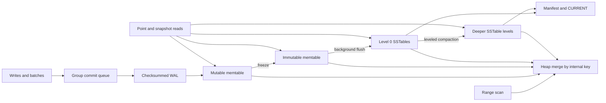

# lsmkv

`lsmkv` is an experimental Rust LSM-tree key-value store for byte keys and byte
values. It has a WAL, versioned memtables, sorted tables, snapshots, Bloom
filters, a block cache, and background leveled compaction. See `DESIGN.md` for
the detailed formats and concurrency design.

## Architecture



Internal keys sort by user key ascending and sequence number descending. A
snapshot pins a sequence; reads use the newest visible version and hide
tombstones. Level 0 can overlap; deeper levels have disjoint user-key ranges.
The manifest publishes live files after their contents are synced.

## CLI

Arguments are UTF-8 text; the library API supports arbitrary bytes. `get` writes
the raw value followed by a newline and exits nonzero when absent. `scan` prints
hexadecimal key and value pairs separated by a tab, one per line; START is
inclusive and END is exclusive. Among key-value commands, only `put` creates a
missing database.

```sh
cargo run --bin lsmkv-cli -- put .agent-local/example-db greeting hello
cargo run --bin lsmkv-cli -- get .agent-local/example-db greeting
cargo run --bin lsmkv-cli -- scan .agent-local/example-db a z
cargo run --bin lsmkv-cli -- stats .agent-local/example-db
cargo run --bin lsmkv-cli -- compact .agent-local/example-db
cargo run --bin lsmkv-cli -- delete .agent-local/example-db greeting
cargo run --bin lsmkv-cli -- verify .agent-local/example-db
```

`stats` reports live file counts and bytes per level, write amplification,
block-cache hit rate, and Bloom-filter savings. Counters other than live files
and bytes are **process-local**, so a new CLI invocation normally starts with
zero counters. Write amplification is SSTable bytes written divided by logical
key/value bytes, excluding WAL and manifest bytes; rates are zero with no
observations.

`verify` requires the database to be closed. It takes the existing exclusive
lock and validates `CURRENT`, the manifest log, every recognized `WAL` or
numbered WAL, and every `SST-*.sst` file, including orphan tables. It validates
all checksums in those files without performing recovery or truncation. Temporary
files and unrelated files are not checked; `CURRENT` and `LOCK` have no checksum.

## On-disk format

`CURRENT` points to the checksummed append-only manifest. The manifest records
file additions/removals, the next file number, and the flushed sequence. WAL
records contain a CRC32C, payload length, record type, and a batch of sequenced
mutations. SSTables contain prefix-compressed data blocks with restart points,
a Bloom filter, an index, block CRC32Cs, and a fixed footer. Numbers are
little-endian except user-supplied bytes. See `DESIGN.md` for exact layouts.

## Guarantees and limitations

- The default WAL policy calls fsync before acknowledging writes; an explicitly
  configured interval policy can lose recently acknowledged writes on a crash.
  A failed write can still appear after recovery. An OS advisory lock prevents
  simultaneous opens of the same database directory.
- Batches are atomic records. Recovery replays complete records after the last
  manifested flush and truncates torn WAL tails; complete corrupt WAL records
  are rejected rather than silently truncated. Use offline `verify` before
  opening if preserving evidence of a torn tail matters.
- Checksums detect accidental corruption, not malicious modification. The
  SSTable footer has no checksum and coordinated changes can evade its layout
  checks. Data durability also depends on the filesystem and hardware; the
  database directory's creation in its parent is not explicitly synced.
- Snapshots are process-local and cannot outlive their database handle. Scans
  materialize their result in memory. Compaction is whole-level rather than
  overlap-minimal; orphan cleanup and an error-returning database close remain
  future work. See `TODO.md` for review findings.
- This implementation, its crash harness and fuzzers have not been validated in
  the current sandbox because Cargo is unavailable. Do not treat it as a
  production durability guarantee until the full checks have passed.
- Neither the property and concurrency tests nor the 200-iteration crash test
  have run here. The fuzz targets ran for zero minutes, and the million-key
  workloads have no measured results or verified optimization.

## Verification and performance

Use the project-local Rust toolchain and at most two test workers:

```sh
RUST_TEST_THREADS=2 scripts/check.sh
RUST_TEST_THREADS=2 cargo test --test property
RUST_TEST_THREADS=2 cargo test --test crash
RUST_TEST_THREADS=2 cargo test --test faults
RUST_TEST_THREADS=2 cargo test --test concurrency
RUST_TEST_THREADS=2 cargo test --release --test concurrency
cargo bench --bench workloads
cargo run --release --bin lsmkv-cli -- bench --seconds 60 --keys 1000000
```

The crash test performs 200 SIGKILL/recovery iterations on Unix. Fuzz setup,
bounded runs, and regression procedures are in `FUZZING.md`; benchmark setup,
machine details, and the absence of measured results are in `BENCHMARKS.md`.
The prioritized handoff, verification gaps, and effort estimates are in
`ROADMAP.md`.
